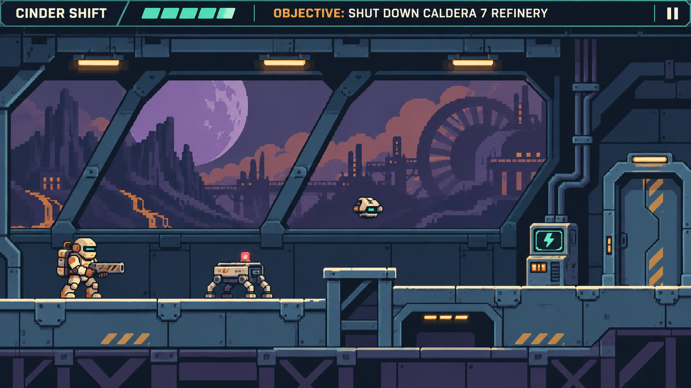

# Cinder Shift — арт дирекшн и задание M03

Третью итерацию посвящаем графике и интерфейсам. Заменяем временный рисунок героя, роботов, трёх комнат и экранов на единый комплект растровых ресурсов. Сохраняем существующие анимационные состояния и их тайминги; плавные переходы и промежуточные кадры в M03 не добавляем.

Визуальная цель показывает атмосферу, материалы и характер силуэтов. Она не задаёт геометрию уровня, точное число сегментов HP, тексты или готовые игровые ресурсы. Для внедрения нужны отдельные слои и выверенные спрайты.

## Предлагаемое направление

Кальдера 7 — ретрофутуристический геотермальный комплекс на вулканической луне. Тяжёлая промышленная архитектура, базальтовые башни, пепельный горизонт и холодная планета за окнами. Мира Вей в кремовом инженерном костюме завершает аварийную смену среди роботов, продолжающих выполнять протокол изоляции.

Из Exolon берём силуэтную ясность, характер тяжёлого костюма и композицию отдельных экранов. Цветовая система современная: нефтяной синий металл, фиолетовые тени, тёплая керамическая броня, мятная электроника и коралловые сигналы опасности.

Целевое направление — экшен роглайт: релизное прохождение 20–30 минут, ориентир 25. После релиза пользователь планирует сюжетные уровни до 60–90 минут общего прохождения. Предлагаем три главы с отдельными забегами; подробности на последней странице. M03 не меняет цикл миссии M02.

---

## Референс и художественные правила

Основной референс — исходная ZX Spectrum версия Exolon. Смотрим на читаемость действий и сочетание технической архитектуры с чужим небом. Реализацию палитры, интерфейса и объектов создаём для Cinder Shift самостоятельно.

| Что видно в референсе | Как применяем в Cinder Shift |
| --- | --- |
| Светлый тяжёлый герой на тёмном фоне | Кремовая броня, крупные ботинки, рюкзак и единая полоса визора. Герой узнаётся по силуэту без подписи. |
| Каждый экран имеет крупную композицию | Один доминирующий объект на комнату: шлюз, окно с турбиной, силовая установка. Чёткий путь между входом и выходом. |
| Цветовые блоки выделяют объекты | Ограниченные палитры материалов и отдельные цвета функций. Яркость соответствует важности для игрока. |
| Объём строится небольшим числом тонов | Три или четыре ступени освещения на материал, единый свет сверху слева, крупные пиксельные кластеры. |
| Инопланетный мир виден за техникой | Базальт, необычные башни, пепельное небо и планета добавляют узнаваемость без новых биомов и механик. |

### Стиль изображения

- Современный пиксель арт с чёткой сеткой. Крупные плоскости, аккуратные скосы, небольшие пятна износа и болтов. Мелкая фактура не заполняет каждую поверхность.
- Мир рисуется строго сбоку. Перспективные элементы разрешены в дальнем фоне; верхние грани игровых платформ совпадают с линией опоры.
- Фон темнее и спокойнее игровых объектов. Декоративные поручни, окна и балки не имитируют доступную платформу и не перекрывают героя.
- Яркий коралл сохраняется для угроз. Мятный используется для доступного взаимодействия и успешного состояния. Надписи, форма и значки дополняют цвет.
- Полное размытие, обильный bloom, VHS фильтр, шум поверх игры и светящиеся контуры всех объектов не входят в направление. Силуэт важнее количества деталей.
### Материалы и мотивы

Базальт — широкие тёмные плоскости и редкие сколы. Окрашенный металл — нефтяной синий с потёртой светлой кромкой. Керамика костюма — тёплая матовая поверхность. Оптика — маленькое мятное окно; угрозы — геометрический коралловый сигнал. Повторяем мотив срезанного угла и маркировку сектора крупными цифрами.

Референсы: https://worldofspectrum.net/item/0001686/ ; https://thekingofgrabs.com/2022/06/20/exolon-zx-spectrum/ . Они нужны для анализа; в игровой пакет изображения референсов не включаются.

---

## Палитра и правила читаемости

Ниже базовые опорные цвета. Производственные спрайты используют небольшие согласованные светотеневые группы; число оттенков не увеличиваем автоматически при генерации. Для одного объекта обычно достаточно трёх или четырёх тонов.

| Цвет | HEX | Назначение |
| --- | --- | --- |
| Базальт | #111823 | Самый тёмный фон, глубокие стыки и внешняя оболочка. |
| Нефтяной синий | #213747 | Основная масса стен и платформ. |
| Стальной синий | #456171 | Освещённая плоскость металла и отдельные конструктивные детали. |
| Фиолетовая тень | #494163 | Дальний ландшафт, стекло и тени промышленного комплекса. |
| Пепельная терракота | #A76B70 | Дальние облака и тёплые участки горизонта; без яркости телеграфа. |
| Керамический крем | #F1D8AE | Главный светлый акцент героя и небольшие опорные кромки. |
| Рабочая охра | #DFA15C | Панели костюма и индустриальная маркировка. |
| Мятная электроника | #76DCC8 | Доступный терминал, питание включено, дружественное состояние. |
| Янтарное внимание | #FFB65B | Подсказка действия и нейтральное внимание; опасные атаки имеют свою форму. |
| Коралловая опасность | #F36D76 | Вражеские снаряды, телеграф атаки и потеря прочности. |
| Светлый текст | #EDF1EC | Основные подписи интерфейса на тёмной подложке. |

### Иерархия сцены

Герой и вражеская атака читаются первыми; терминал и выход вторыми; маршрут третьим; фоновая история последней. В визуальном образце окно довольно яркое: в рабочем варианте приглушить его, если оно спорит с угрозами. Опасные объекты не сливаются с ржавчиной и фоновой лавой.

Проверить кадр в оттенках серого, при уменьшении и на телефоне. Обычный текст интерфейса должен иметь контраст не ниже 4,5:1; для значимых нетекстовых элементов целимся в 3:1 к соседней поверхности. Это критерии проверки макета, а не утверждение, что все пары базовой палитры уже подходят.

---

## Герой роботы и предметы

### Мира Вей

Рабочий инженер, а не солдат. Закрытый короткий шлем с горизонтальным визором, тяжёлые ботинки, округлая грудная броня, компактный рюкзак с двумя цилиндрами, промышленный резак. Кремовые основные плоскости, охристые вставки, тёмные сочленения и маленький мятный визор. На уровне игры характер передают силуэт и поза; портрет лица не требуется.

Для стоячего состояния ориентир — холст 48 × 64 логических пикселя с прозрачными полями. Якорь стоп единый; видимый корпус должен соответствовать существующему телу 22 × 44 px. При приседании ориентир высоты тела 26 px. После M02 сверить эти значения с фактической сборкой. Размер холста не становится размером коллайдера.

- Нарисовать все уже существующие позы: покой, движение, прыжок/падение, приседание, выстрел, попадание и смерть — только если соответствующее состояние существует в принятом M02. Одна поза может обслуживать несколько состояний.
- Сохранить одинаковую длину ног, положение шлема и привязку оружия между кадрами. Стопы не прыгают при смене текстуры. Точка выхода пули совпадает с дулом.
- Базовый набор ориентирован вправо. Отражение влево допустимо для симметричных частей; уникальные знаки и дуло проверить отдельно. Лицо, пропорции и дизайн не меняются от кадра к кадру.
| Набор | Образ и обязательные состояния | Техническая основа |
| --- | --- | --- |
| Ходок | Низкий ремонтный робот на четырёх опорах, прямоугольный корпус, верхний маяк. Патруль, подготовка атаки, выстрел, разрушен — по существующим слотам. | Предлагаемый холст 48 × 32; коллайдер и тайминги берём из M02. |
| Дрон | Компактный клиновидный корпус, боковые сопла и нижний сенсор. Маршрут, зависание, наведение, выстрел, разрушен — по M02. | Предлагаемый холст 32 × 32; точка сенсора совпадает с маркером. |
| Мишень | Учебная механическая стойка, отличная по форме от живого врага. Целая, повреждённая и сбитая — по доступным состояниям. | Ориентир 24 × 40; визуал согласован с текущей зоной попадания. |
| Терминал и шлюз | Крупная форма силового шкафа; питание выключено/доступно/включено. Шлюз закрыт/открыт. | Терминал ориентир 32 × 64, шлюз 48 × 96; размеры адаптировать к готовой геометрии. |

Холсты выше являются предложением для упаковки. Work сначала фиксирует реальные габариты M02, затем корректирует прозрачные поля и размещение рисунка. Подгонять физику и уровень под красивую картинку в графическом этапе нельзя.

---

## Окружение трёх комнат

| Комната | Визуальный мотив | Объекты и читаемый маршрут |
| --- | --- | --- |
| A Входной шлюз | Узкий служебный отсек перед сменой; тёплая керамика и спокойные мятные индикаторы. | Шкаф костюма, предупреждающая маркировка, учебная мишень, низкий проход и шлюз. Фон не похож на поверхность для прыжка. |
| B Сервисный коридор | Большие окна на базальтовый горизонт, планету и геотермальную турбину. | Один крупный фоновый силуэт, укрытие, верхняя полка, место дрона. Оконные рамы не перекрывают линию вражеского огня. |
| C Силовой щиток | Силовой зал с тяжёлыми шинами и корпусом генератора. Более напряжённый свет. | Щиток питания и выход заметны без подсказки голосом. После включения меняются разрешённые статические состояния индикаторов и двери. |

### Пакет окружения

- Один базовый набор тайлов 16 × 16: пол, верхняя кромка, торцы, стена, внутренний угол, нижняя поверхность, решётка, опора и технологическая панель. Варианты текстуры не создают новые коллизии.
- Три фоновых композиции под мир 640 × 320 плюс готовый пример в кадре 640 × 360 с HUD. Фон состоит из дальнего ландшафта и архитектуры; в M03 эти слои статичны.
- До 12 декоративных элементов: окно, турбина, пучок кабелей, силовая шина, шкаф, светильник, маркировка, вентиляция и варианты опор. Крупные элементы собираются из модулей или отдельной текстуры.
- Набор выстрелов, попаданий и предупреждений соответствует количеству кадров и времени жизни уже работающих эффектов. Вражеская пуля отличается от своей формой, контуром и цветом.
### Что сдаёт художник

Сначала один выверенный игровой кадр B с героем, ходком, дроном, укрытием, терминалом и HUD. Затем комплект A и C на том же наборе материалов. Завершить отдельными слоями и атласами, а не тремя сведёнными изображениями, которые невозможно использовать в игре.

Нужны исходник со слоями, прозрачные PNG, PNG атлас и JSON с именами областей, карта тайлов, список состояний и пример масштаба 1:1. Допустим Aseprite, PSD или Krita; экспорт должен воспроизводиться из исходника. UI текст хранится в приложении, а не запекается в картинки.

Временные фигуры убираются из обычного режима полностью. Технические коллайдеры и диагностические подписи можно оставить за отдельным debug переключателем. Остаточные прямоугольники не должны смешиваться с финальными спрайтами.

### Подготовка визуала модулей

В слоях костюма оставить точки для будущих модулей оружия, движения и защиты: насадка резака, блок рюкзака, плечевая панель. Их переключение будет статичным. В M03 достаточно структуры слоёв и единого языка значков; новые исследования, экраны выбора и изменения правил забега не внедряем.

---

## Интерфейсы и состояния

Интерфейс напоминает панель рабочего костюма: крупные подписи, срезанный угол, тонкая рамка, спокойная тёмная подложка. Иллюстрации и логотип поддерживают игру; игровое поле остаётся главным элементом страницы. Используем чёткий системный или локально поставляемый sans-serif с кириллицей; моноширинный шрифт — для версии и технических кодов.

| Экран | Что оформить | Обязательные состояния |
| --- | --- | --- |
| Главный | Название, короткий контекст смены, «Начать», «Настройки», версия. Сдержанный фрагмент комплекса на фоне. | Обычное, фокус, нажатие, отключено. «Продолжить» только после реализации сохранений. |
| Брифинг | Название миссии, одна обязательная цель, подсказки устройства, «Начать миссию». | Данные выбранной миссии; корректная клавиатура/сенсор/геймпад. |
| HUD | Шесть сегментов HP и числовое значение, цель, комната, пауза. Модуль только когда он реально доступен. | Полное и неполное HP, новая цель, доступный interact, прогресс удержания. |
| Пауза и настройки | Продолжить, звук, управление, выход. Непрозрачная или достаточно плотная подложка. | Ручная пауза, фон, поворот экрана, настройки в фокусе. |
| Победа и смерть | Понятный итог, причина смерти при поражении, активное время, повтор и меню. | Разные пиктограммы и заголовки для победы и поражения. |
| Загрузка и ошибка | Индикатор загрузки, понятное сообщение, повтор загрузки. | Пустое, загрузка, сбой, восстановление. Прогресс не имитирует несуществующий процент. |
| Телефон | Сенсорные направления и действия, просьба повернуть устройство. | Idle/held/disabled; pointercancel; ручной и автоогонь; safe area. |

### Размеры и размещение

Сохранить логический кадр 640 × 360 и HUD 40 px. Кнопка паузы получает реальную область нажатия не меньше 48 CSS px. Для текста меню ориентир 16 CSS px на телефоне; вспомогательный текст не мельче 14 CSS px. Для HUD измерять итоговую экранную величину, а не только размер шрифта в canvas.

На телефоне в альбомной ориентации большие заголовки страницы и диагностика скрыты. Основной touch layout сохраняем из принятого M02; перерисовываем кнопки, не меняя зоны привычного ввода. Не дублировать цель одновременно в нескольких панелях. Визуальная цель на первой странице содержит условные подписи; рабочие тексты берём из M02.

---

## Анимация и техническое внедрение

Главное ограничение пользователя: внедрить графику, оставив анимации как есть, без плавных переходов. Сначала снять фактический список состояний, длительностей, кадров и точек привязки принятого M02. Это исходный контракт M03; новые картинки обслуживают этот контракт.

- Не менять количество кадров, частоту переключения, длительность атак, момент урона, точки спавна пули и правила завершения анимаций. Не добавлять blending, crossfade, tween, интерполяцию поз, motion blur, video или Spine.
- Если состояние сейчас статично, оно остаётся статичным. Если работает дискретная последовательность, заменить кадры один к одному. Мгновенное переключение состояния допустимо и ожидаемо.
- Если анимация процедурная, как движение ног в текущем M0, сохранить её функцию и фазу. При необходимости разнести костюм на растровые слои корпуса, ног и оружия. Перевод такой функции в новую спрайтовую секвенцию в M03 не выполнять.
- Переход между комнатами сохраняет действующую задержку и защиту от урона; новую визуальную плавность к нему не добавлять. Интерфейсные состояния переключаются сразу, без анимации opacity, scale и position.
### Ресурсы и точки привязки

Хранить производственные ресурсы внутри games/cinder-shift/public/assets/m03/. Пример групп: mira-atlas.png/json, enemies-atlas.png/json, props-atlas.png/json, environment-atlas.png/json, bg-a.png, bg-b.png, bg-c.png и ui-icons.svg. SVG допустим для простых интерфейсных знаков; игровой рисунок поставляется растром.

Для каждого кадра описать asset_id, state_id, размеры исходного холста, pivot, точку стоп, muzzle и ссылку на существующий slot_id. Кадры с обрезкой имеют исходные размеры и offset; при сборке атласа нельзя терять выравнивание. Для пиксель арта выключить поворот регионов, дать не меньше 2 px технического отступа и проверить ореолы прозрачности.

Коллайдеры, геометрия комнат, AI, скорость движения, кулдауны и радиусы взаимодействия сохраняются. Отдельный render слой привязан к игровому телу. Сначала сравнить рисунок и debug тело на каждой позе; особенно приседание, край платформы, направление оружия и положение после урона.

### Загрузка и масштаб

Сохраняем Phaser и Vite. Грузим локальные файлы через Boot/Preload; никаких внешних CDN. PixelArt и nearest-neighbour для растров, целые координаты отрисовки без смещения физического тела. Целевой масштаб целочисленный, когда помещается; при дробном fit на телефоне проверяем читаемость и отсутствие обрезки.

Общий бюджет первой загрузки остаётся до 10 МБ сжатых ресурсов; целевой добавленный вес графики до 5 МБ. Цель 60 FPS на тех же устройствах, что у M02. PNG сохраняет резкость и прозрачность; lossless WebP допустим после визуальной проверки. Бюджет контролируем по реальному билду.

---

## Задание Work и приёмка M03

На 5 ноября подтверждён игровой код M0 e3551ee и задание M02, но завершённой M02 ветки в удалённом репозитории пока нет. Производственное внедрение M03 выполняется поверх принятой первой миссии. Можно заранее готовить графику, палитру и UI; нельзя объявлять три комнаты внедрёнными по одному макету.

### Порядок выполнения

- 1. Взять фактический результат M02, записать SHA, размеры комнат и контракт анимации. Создать ветку codex/cinder-shift-m03-art. Если M02 ещё в разработке, готовить независимые ресурсы и не заменять боевую логику макетом.
- 2. Зафиксировать палитру в коде и таблицу ассетов. Подготовить игровой кадр B, проверить героя и угрозы в реальном масштабе. Сверить с визуальной целью и правилами читаемости.
- 3. Подготовить героя, двух роботов, предметы и общий набор окружения. Сохранить исходники, экспорт и карту состояний. Проверить края, точки привязки и соответствие размерам.
- 4. Подключить графику во все комнаты и существующие состояния. Перерисовать перечисленные интерфейсы и сенсорные кнопки. Удалить временный рисунок из обычного режима.
- 5. Сравнить прохождение и анимационные тайминги с M02, выполнить build и проверки. Опубликовать версионный артефакт через nutsbid на существующем Cloudflare стенде.
| Критерий | Как подтвердить |
| --- | --- |
| Единый стиль | A, B и C, герой, роботы, эффекты и экраны соответствуют одной палитре и материалам; нет смешения временной и производственной графики. |
| Читаемость | В реальном масштабе видны герой, линия опоры, вражеская атака, терминал и выход. Фон не спорит с боем; текст читается на телефоне. |
| Анимация сохранена | Сравнение списка кадров/состояний/длительностей до и после. Нет новых tween, crossfade и промежуточных поз; события боя происходят в прежнее время. |
| Игра сохранена | Одинаковые коллайдеры и геометрия; проходят A → B → C, смерть, retry, возврат в комнату, пауза и смена ввода. Дуло совпадает с пулей. |
| Публикация | Рабочий URL, build_id, SHA исходников и публикации, манифест ресурсов, проверка загрузки и консоли, кадры ПК/телефона и краткое видео. |

### Обновление дальнейшего плана

Это задание меняет прежнюю очередь: M03 теперь графика и UI; бывшая вертикальная сессия с тремя первыми технологиями, двумя событиями и сохранениями переходит в M04. Затем M05 полная кампания, M06 полировка выпуска, M07 итоговая проверка и M08 публикации на площадках. Нумерация не означает завершение этапов.

Готовый результат M03 — игра с внедрённой графикой на демо стенде и сохранённым поведением анимации. Презентационный кадр и набор неподключённых PNG сами по себе этап не закрывают.

---

## Сюжетное развитие после релиза

Решение пользователя: после релиза продолжать игру сюжетными уровнями и довести общее прохождение до 60–90 минут. Для релиза сохраняем короткий самостоятельный выпуск с успешным прохождением примерно за 20–30 минут. Эти значения — цели дизайна; их нужно подтвердить плейтестами без учёта пауз и повторов.

### Предлагаемая структура

Разделить будущую кампанию на три сюжетные главы по 20–30 минут. Одна глава соответствует отдельному забегу. Открытие следующих глав сохраняется; смерть сбрасывает текущий забег, а не весь пройденный сюжет. Эта схема предложена для реализации роглайта в M04 и не является уже работающей системой M02.

| Часть | Целевой объём | Сюжетная и визуальная роль |
| --- | --- | --- |
| Глава 1 в релизе | 20–30 минут | Кальдера 7: авария, запуск линии и выход из изолированного сектора. Завершённая локальная цель и первый ответ на проблему. |
| Глава 2 после релиза | Ещё 20–30 минут | Предлагаемое направление: наружные фермы комплекса и поиск источника ложного аварийного сигнала. Больше открытого пространства, базальта и индустриальных силуэтов. |
| Глава 3 после релиза | Ещё 20–30 минут | Предлагаемое направление: управляющее кольцо, причина изоляции и окончательное решение судьбы комплекса. Развиваем знакомые материалы и силуэты, усиливаем масштаб. |

### Случайность внутри сюжетного каркаса

- Сюжетные вехи и обязательные цели имеют заданный порядок. Между попытками меняются допустимые события, сочетания угроз и выбор улучшений; ключевой поворот истории не зависит от редкого случайного выпадения.
- Короткий забег остаётся удобной единицей сессии. Закрытие вкладки между секторами сохраняет текущий прогресс после внедрения сохранений. Смерть и обычный выход из игры имеют разные последствия.
- Новые главы расширяют ситуации и историю. Длительность не набираем принудительными повторами, ростом HP врагов или одинаковыми коридорами. Число новых миссий назначаем после измерений первой главы.
### Что это меняет в графическом задании

Сейчас производим комплект первой миссии. Палитра, модульный металл, базальт, окна, маркировка секторов и слои костюма должны допускать новые комнаты. Для будущих глав можно добавлять собственный фоновый мотив и акцент материала, сохраняя героя и язык угроз. В M03 не рисуем сразу 90 минут уровней и не добавляем неработающие кнопки новых глав.

Предлагаемые названия и события глав уточняются после выпуска первой версии. Решение о расширении до 60–90 минут зафиксировано; конкретная структура из трёх глав является рабочей рекомендацией.

